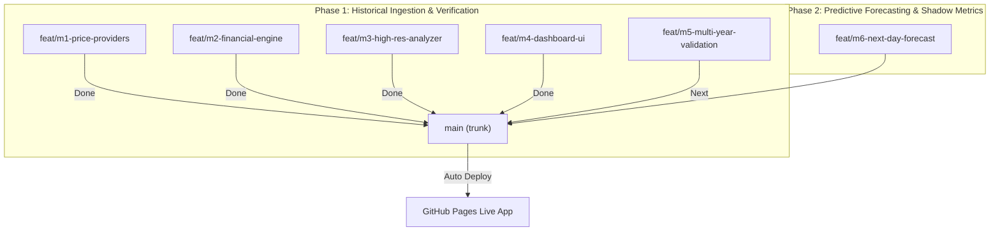
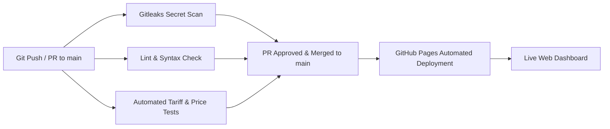

# Product Requirements Document (PRD): MySunshine

A comprehensive system to track, simulate, and calculate the actual financial return on investment (ROI) for a household solar panel and home battery system in Sweden (SE3), with future capabilities for solar forecasting, smart charging, and price arbitrage.

---

## 1. Objectives

### Core Objective (Phase 1: Multi-Year Historical ROI & Calculation Validation)
Calculate, verify, and validate the **true financial ROI and savings** of the solar and battery installation using real historical electricity price data (Nordpool SE3 / Tibber) and actual multi-year consumption/production logs (2021–2026).
- Ingest and cross-validate multi-year Sonnen data: **2023** (from September 11 kWh battery install), **2024** (full year with 11 kWh to 22 kWh expansion on Sep 9), **2025** (full year with dual 22 kWh battery), and **2026** (high-resolution hourly/quarterly logs).
- Quantify total savings against realistic 3-way baselines (No Solar/Battery, Solar-only).
- Isolate the **marginal financial contribution** of the SonnenBatterie 10 across both single-module (11 kWh) and dual-module (22 kWh) configurations.
- Account for Swedish electricity market specifics: spot prices (both hourly and 15-minute/quarterly), energy tax (*energiskatt*), grid fees (*nätavgift*), grid benefit (*nätnytta*), 25% VAT (*moms*), Tibber fees, and micro-production tax deduction (*skattereduktion* 60 öre/kWh).
- Ensure calculations, graphs, and energy balances are thoroughly validated and audited against actual utility bills before undertaking automated control.

### Future Objective (Phase 2: Predictive Forecasting & Shadow Recommendation Engine)
Postpone active battery hardware control until historical calculations and predictive models have been validated over time. Focus on predictive metrics and shadow evaluation:
- **Next-Day Cost & Savings Forecast**: Provide a forecast of expected electricity cost and savings for the coming day based on historical consumption patterns, tomorrow's published day-ahead spot prices, and local weather forecasts.
- **Dynamic Charging Recommendation Engine (Shadow Mode / Metrics Only)**: Produce recommendations for optimal grid pre-charging or dispatch without physically manipulating battery hardware.
- **Predictive vs. Actual Backtesting**: Automatically evaluate predictions the following day (e.g., *"The recommendation engine would have saved/lost X SEK compared to actual dispatch"*), measuring theoretical optimization upside against real-world performance.

---

## 2. System Hardware, Capex & Environmental Configuration

* **Bidding Zone**: **SE3** (Sweden - Stockholm / Central Sweden, Nordpool market).
* **Electricity Retailer (Elhandelsbolag)**: **Tibber** (`https://tibber.com/se`).
  * Price Model: Dynamic spot pricing.
  * **Pricing Resolution Transition Date**: **2025-10-01** (Switched from 60-min hourly prices to 15-min quarterly prices).
  * Fixed Subscription: 49 SEK / month (incl. moms).
* **Grid Operator (Elnätsbolag)**: **Eskilstuna Energi & Miljö (EEM)** (`https://eem.se`).
* **Solar PV System**:
  * Inverter: **SMA Inverter model STP8.0-3AV-40** (3-phase, 8.0 kW AC rating).
  * **Installation Date**: **January 2021** (Starting point of the investment).
  * **Solar Panels Net Capex**: ~**165,000 SEK** (Net out-of-pocket after *Grön Teknik* deduction; ~206,250 SEK gross).
* **Battery Storage**: **SonnenBatterie 10 performance**:
  * **Phase 1 Installation Date**: **September 2023** (11 kWh module).
  * **Phase 2 Expansion Date**: **September 9, 2024** (Additional 11 kWh module added -> Total ~22 kWh nominal / ~20 kWh usable).
  * **Total Battery Net Capex**: ~**150,000 SEK** (Net out-of-pocket after 50% *Grön Teknik* deduction; ~300,000 SEK gross).
  * Continuous Power: Up to 7.0–8.0 kW.
  * Observed Round-Trip Efficiency: ~76.7% – 77.0%.
* **Combined Investment Totals**:
  * **Total Net Capex (Actual Out-of-Pocket)**: ~**315,000 SEK** (165,000 SEK Solar Net + 150,000 SEK Battery Net).
  * **Gross Total System Cost (Pre-Subsidy)**: ~**506,250 SEK** (~206,250 SEK Solar Gross + ~300,000 SEK Battery Gross).
* **Historical Data Coverage**:
  * **2021–2023 (Aug)**: Solar Only period (`data/sunnyportal-sma-inverter-data-2026-10-24.csv` and `data/eem-meter-readings-402520-2026-10-24-20-10-44-5195.csv`).
  * **2023 (Sep–Dec)**: 11 kWh SonnenBatterie 10 (`data/sonnen_energy_data_2023.csv`).
  * **2024 (Full Year)**: 11 kWh (Jan–Aug) transitioning to 22 kWh (Sep 9+) (`data/sonnen_energy_data_2024.csv` and `data/eem-yearly-costs-2024-2026.csv`).
  * **2025 (Full Year)**: 22 kWh dual module full year (`data/sonnen_energy_data_2025.csv`).
  * **2026 (Full YTD + 94-day High-Res)**: 242-day continuous operational record + 94-day high-resolution hourly/quarterly time-series (July 16 – Oct 17, 2026).
* **Execution & Data Hub**:
  * Primary: **Home Assistant Green** (local polling, long-term statistics storage, automation hub).
  * Fallback / Analysis Host: Dedicated Ubuntu laptop running 24/7.
* **Network & Local Device Endpoints**:
  * Home Assistant Green: `192.168.3.138` (`http://ha.home`)
  * SonnenBatterie 10: `192.168.3.125` (`http://sonnen.home`)
  * SMA Inverter: `192.168.3.61` (`http://sma.home`)

---

## 3. Data Architecture & Integration Strategy

```mermaid
flowchart TD
    subgraph Data Sources
        sonnen[SonnenBatterie Local API / App Export]
        sma[SMA Inverter Webconnect / HA Integration]
        tibber[Tibber API / HA Tibber Integration]
        ha[Home Assistant Green History DB]
        price_apis[Modular Price Providers: Tibber / ENTSO-E / Elering / Energy-Charts]
    end

    subgraph Core Engine: MySunshine Analyzer
        ingest[Data Ingestion & Multi-Resolution Normalizer (15-min / Hourly / Daily)]
        price_mod[Price Matching & Swedish Tariff Engine (Tibber + EEM SE3)]
        baseline[3-Way Baseline Engine (No Solar vs. Solar Only vs. Solar+Battery)]
        roi_calc[ROI, Capex & Cash Flow Calculator]
    end

    subgraph Outputs
        ui[Interactive Dashboard & Charts]
        ha_sensor[HA Custom Sensors & Dispatch Advice (Phase 2)]
    end

    sonnen --> ingest
    sma --> ingest
    tibber --> ingest
    ha --> ingest
    price_apis --> price_mod
    ingest --> price_mod
    price_mod --> baseline
    baseline --> roi_calc
    roi_calc --> ui
    roi_calc --> ha_sensor
```

### A. Energy Data Ingestion & Resolution Matching

Because the electricity market transitioned from hourly to 15-minute prices on **2025-10-01**, the analyzer supports dynamic multi-resolution alignment:

1. **Pre-2025-10-01 Timeline (Hourly Market)**:
   * Market spot prices: Hourly (60 min).
   * Energy data: Ingested as hourly or mapped from daily aggregated totals.
2. **Post-2025-10-01 Timeline (15-Minute / Quarterly Market)**:
   * Market spot prices: 15-minute intervals (96 intervals/day).
   * **When Energy Data is Hourly (e.g. Sonnen 30-day export)**: The 4 quarterly prices within each hour are arithmetic/volume averaged for the hourly block, or synthetic quarter-hour disaggregation is applied.
   * **When Energy Data is 15-Minute (e.g. Tibber API / Home Assistant logs)**: Exact interval-by-interval multiplication for peak precision.
3. **Daily Aggregated Time-Series (2025 Historical Baseline)**:
   * Evaluated using synthetic diurnal load/generation profile weighting across the year.

### B. Modular Historical Electricity Price Engine

A pluggable adapter interface (`PriceProvider`) to fetch and cache historical SE3 spot prices with automatic fallback:

| Provider | Data Coverage | Granularity | Auth / API Key | Use Case |
| :--- | :--- | :--- | :--- | :--- |
| **Tibber API (GraphQL)** | Exact household prices & historical spot | 15-min (post-2025-10-01) & Hourly (pre-2025-10-01) | Free Personal Access Token | Direct retailer ground truth |
| **ENTSO-E Transparency Platform** | Official European TSO | Hourly & 15-min | Free API Token (via email) | Primary European official source |
| **Elering API** | Nordic & Baltic Bidding Zones | Hourly | None (Public REST) | Instant fallback & verification |
| **Energy-Charts API (Fraunhofer ISE)** | European Day-Ahead Spot | Hourly | None (Public REST) | Robust secondary fallback |
| **Local Cache / Static File Adapter** | User-supplied or pre-fetched | Any | Local file | Offline & rapid test execution |

### C. Configuration, Endpoints & Secrets Management

All external API endpoints, local hardware URLs, and private security tokens are managed via a local, git-ignored `.env` file:
* **External Price APIs**:
  * `ENTSOE_API_URL` & `ENTSOE_API_KEY`: ENTSO-E Transparency Platform endpoint & security token.
  * `TIBBER_API_URL` Tibber GraphQL endpoint. 
  * `TIBBER_API_TOKEN`: Tibber GraphQL token for these scopes:
    * tibber_graph
    * user
    * homes
    * price
    * consumption
  * `ELERING_API_URL`: Elering public spot price API endpoint.
  * `ENERGY_CHARTS_API_URL`: Fraunhofer Energy-Charts API endpoint.
* **Local Hardware & Hub Endpoints**:
  * `HA_URL` & `HA_TOKEN`: Home Assistant Green base URL and optional Long-Lived Access Token.
  * `SONNEN_URL` & `SONNEN_API_TOKEN`: SonnenBatterie 10 local API base URL & token.
  * `SMA_URL`: SMA Inverter Webconnect URL.
* A template [` .env.example `](file:///C:/Users/chris/.gemini/antigravity-ide/scratch/mysunshine/.env.example) is committed to version control to provide the full configuration schema.

---

## 4. Swedish Electricity Pricing & Tariff Model (Tibber + EEM / SE3)

To determine the true financial payoff, every kWh imported and exported is calculated using the Swedish market tariff structure:

### 1. Grid Import Cost Formula ($C_{\text{import}}$)
$$C_{\text{import}}(t) = \left( \text{SpotPrice}_{\text{SE3}}(t) + \text{TibberMarkup} + \text{Elcertifikat} + \text{Energiskatt} + \text{Överföringsavgift}_{\text{EEM}} \right) \times (1 + \text{Moms}_{25\%})$$
* **SpotPrice**: 15-minute quarterly or hourly spot price (öre/kWh).
* **Tibber Markup & Certificates**: Variable retailer cost component.
* **Energiskatt (Energy Tax)**: Government energy tax (~42.8–53.5 öre/kWh incl. VAT).
* **Överföringsavgift (EEM Grid Transfer Fee)**: Variable distribution fee from Eskilstuna Energi & Miljö.
* **Moms**: 25% Swedish Value Added Tax applied to all applicable components.
* **Fixed Monthly Costs**: Tibber base fee (49 SEK/mo) + EEM grid connection subscription (*säkringsavgift*).

### 2. Grid Export Revenue Formula ($R_{\text{export}}$)
$$R_{\text{export}}(t) = \text{SpotPrice}_{\text{SE3}}(t) + \text{Nätnytta}_{\text{EEM}} + \text{Skattereduktion}_{60\text{öre}}$$
* **SpotPrice**: Received spot price per exported kWh via Tibber.
* **Nätnytta (EEM Grid Benefit)**: Payment from EEM for localized micro-production grid relief (~5–10 öre/kWh, tax-free).
* **Skattereduktion (60 öre/kWh)**: Tax reduction for green micro-production (*skattereduktion för mikroproduktion av förnybar el*, inkomstskattelagen 67 kap).
  * **2021-01-01 to 2025-12-31**: Active at 60 öre/kWh.
  * **2026-01-01 onwards**: **Abolished by Swedish law** (0 öre/kWh).
  * **Economic Impact**: Abolition of the export tax reduction fundamentally alters home battery economics: without the 60 öre export subsidy, storing surplus solar in the battery is far more lucrative than exporting it to the grid for only spot + 8 öre nätnytta.

---

## 5. Feature & Visualization Requirements

### Phase 1: Historical ROI & Financial Analytics

#### 1. Core Financial Engine
* **3-Way Comparative Financial Baselines**:
  * **Baseline 1 (No Solar, No Battery)**: Simulates total electricity bill if 100% of household consumption had to be purchased from the grid.
  * **Baseline 2 (Solar Only, No Battery)**: Simulates the financial outcome if solar panels were installed without a battery (direct self-consumption capped at instant load, remainder exported).
  * **Actual (Solar + SonnenBatterie 10)**: Realized electricity bills and export revenues.
  * **Marginal Battery Value**: $\text{Savings}_{\text{Actual}} - \text{Savings}_{\text{Solar-Only}}$ to isolate the exact annual SEK contribution of the battery.
* **Capex & Investment Payback Tracking**:
  * Configurable Net Capex input (after Swedish *Grön Teknik* deduction: 20% solar, 50% battery).
  * Computes percentage of Capex recouped to date, remaining unrecovered balance, and dynamic break-even year.
* **Battery Health & Performance Diagnostics**:
  * Tracks real-world round-trip efficiency (observed ~76.7%–77.0%), annual cycle counts, and standby energy losses.

#### 2. Dashboard UI & Visualization Blueprint
The web interface will feature a modern dark-theme dashboard with interactive visualizations:

1. **Top-Level KPI Dashboard Cards**:
   * **Total Savings to Date (SEK)**: Cumulative financial gain compared to the "No Solar" baseline.
   * **Capex Recouped Progress Gauge / Card**: e.g., *"34.2% of Capex Recouped (112,400 / 328,000 SEK)"* with a radial progress ring.
   * **Payback Period Estimate**: Estimated years to break-even based on historical run-rate and energy inflation.
   * **Marginal Battery Contribution**: Extra SEK earned solely due to battery load shifting.
   * **Annual CO₂ Offset**: Kilograms/tonnes of carbon emissions avoided.

2. **Cumulative Cash Flow & Payback S-Curve (Chart 1)**:
   * Line chart starting below zero ($-\text{Capex}$) at Year 0 and ascending through time.
   * Shows historical actuals (solid green curve) transitioning into 25-year projections (dashed line).
   * Highlights the Break-Even point ($0 line intersection) with an interactive milestone marker.

3. **3-Way Baseline Monthly Comparison (Chart 2 - Stacked Bar)**:
   * Side-by-side monthly cost breakdown comparing:
     1. Bill without Solar/Battery (Grey)
     2. Bill with Solar Only (Amber)
     3. Actual Bill with Solar + Battery (Teal)
   * Visually reveals winter vs. summer savings dynamics.

4. **Hourly Dispatch & Price Heatmap (Chart 3 - Interactive Time-Series)**:
   * Dual-axis chart overlaying 15-min/hourly SE3 spot prices against battery state-of-charge (SoC), solar generation, and home load.
   * Visually highlights how the battery charges during cheap hours and discharges during peak price spikes.

5. **25-Year Detailed Financial Ledger Table**:
   * Year-by-year tabular view: Solar Gen, Self-Consumption, Exported kWh, Imported kWh, Raw Bill, Solar Bill, Annual Savings, and Net Cumulative Balance.

---

### Phase 2: Predictive Forecasting & Shadow Recommendation Engine

1. **Next-Day Cost & Savings Forecasting**:
   * Ingest day-ahead hourly/15-minute spot prices (published daily at ~13:00 CET by Nordpool/Tibber).
   * Integrate solar generation forecasts (via SMA Inverter data, Open-Meteo, or Forecast.Solar) and local weather forecasts (irradiance, temperature).
   * Project estimated household consumption profile and next-day electricity bill/savings against the "No Solar" baseline.

2. **Dynamic Grid Pre-Charging & Arbitrage Advisor (Shadow Mode / Metrics Only)**:
   * Evaluate tomorrow's price curve against predicted household load and forecasted solar generation.
   * Model whether pre-charging the battery during cheap night hours would yield positive financial return under the efficiency gate:
     $$\Delta \text{Price} > \frac{C_{\text{import}}}{\eta_{\text{roundtrip}}} - R_{\text{export}} + \text{LossMargin}$$
   * Output explicit actionable recommendations without actively controlling the hardware (e.g. *"Pre-charge 10 kWh between 02:00–05:00 at avg 18 öre/kWh to cover morning peak spike at 145 öre/kWh"*).

3. **Prediction vs. Actual Backtesting & Value Delta Tracking**:
   * Log daily recommendations and expected financial impact.
   * Compare projected outcomes against actual realized energy logs the next day.
   * Compute exact benchmark metric: *"The recommendation engine would have saved/lost X SEK compared to actual dispatch"*, verifying algorithm value before enabling physical control.

---

## 6. Implementation Roadmap & Verifiable Milestones

Development is organized around **Milestone Branches** (`feat/mX-...`) that merge into `main` via GitHub Pull Requests, with CI/CD automation:



### Milestone 1: Price Ingestion, Provider Module & CI Foundation (Completed)
* **Branch**: `feat/m1-price-providers`
* **Deliverables**: Pluggable `PriceProvider` interface, caching, Elering/ENTSO-E/Tibber providers, and CI with Gitleaks & Flake8.

### Milestone 2: 2025 Full-Year ROI & Baseline Engine (Completed)
* **Branch**: `feat/m2-financial-engine`
* **Deliverables**: Swedish tariff calculator (EEM fees, tax reduction, moms), 3-way baseline engine, Capex payback calculator, and CLI tool.

### Milestone 3: High-Resolution 30-Day & Multi-Resolution Engine (Completed)
* **Branch**: `feat/m3-high-res-analyzer`
* **Deliverables**: 744-hour high-res ingestion, multi-res matching (15-min to hourly), and daily-average estimation variance benchmarks.

### Milestone 4: Interactive Web Dashboard & GitHub Pages CD (Completed)
* **Branch**: `feat/m4-dashboard-ui`
* **Deliverables**: Modern dark-theme glassmorphic UI, 25-year calendar S-Curve (2021-2045), 3-way baseline bar chart, 24h dispatch overlay, static data baking pipeline, and automated GitHub Pages CD workflow (`.github/workflows/deploy.yml`).

### Milestone 5: Multi-Year Historical Expansion (2023–2026) & Calculation Validation (Completed)
* **Branch**: `feat/m5-multi-year-validation` (Merged & Committed: `6e6e00c`)
* **Deliverables**:
  * `5.1 Multi-Year Sonnen CSV Ingestion`: Ingested `sonnen_energy_data_2023.csv` (Sep–Dec 2023), `sonnen_energy_data_2024.csv` (Full Year 2024), `sonnen_energy_data_2025.csv` (Full Year 2025), and 2026 YTD with automated deduplication across overlapping files.
  * `5.2 Hardware Transition Modeling`: Modeled Era 1 (Solar Only), Era 2 (11 kWh SonnenBatterie 10 Sep 2023 – Sep 8, 2024), and Era 3 (22 kWh SonnenBatterie 10 Expansion Sep 9, 2024 – Present).
  * `5.3 Historical Spot Price Ingestion & Matching`: Ingested and cached full SE3 spot prices across 2023, 2024, 2025, and 2026 with sub-hourly (15-min) pricing resolution support in Swedish local time (CET/CEST).
  * `5.4 Calculation Engine Fixes & Verification`:
    * Normalized diurnal profile weights (`DEFAULT_DIURNAL_LOAD_WEIGHTS` and `DEFAULT_DIURNAL_SOLAR_WEIGHTS`) so hourly coefficients sum strictly to 1.0.
    * Implemented date-aware Skattereduktion terminating the 60 öre/kWh subsidy on 2026-01-01.
    * Re-baked static dashboard package (`dashboard_data.json` and `dashboard_data.js`).
  * `5.5 3-Way Baseline Chart Augmentations`:
    * Augmented Chart 2 with diagonal hatched pattern depicting the exact Skattereduktion subsidy share on affected columns during valid years (2021–2025).
    * Dynamic title toggle between "3-Way Baseline Yearly Comparison" (All Historical Data) and "3-Way Baseline Monthly Comparison" (single-year views).
* **Verification Gate**:
  * 38/38 unit and multi-resolution integration tests passing; all pre-push checks green.

### Milestone 5.5: Full Day-1 Historical Expansion (2021–2023 Solar Era) & Utility Audit (Completed)
* **Branch**: `feat/m5.5-day1-historical-expansion`
* **Deliverables**:
  * `5.5.1 SMA Inverter Solar Yield Ingestion`: Ingest monthly production logs from `data/sunnyportal-sma-inverter-data-2026-10-24.csv` (8,381.5 kWh in 2021, 9,038.1 kWh in 2022, 8,532.4 kWh in 2023).
  * `5.5.2 EEM Utility Meter Readings Ingestion`: Ingest official monthly export meter readings from `data/eem-meter-readings-402520-2026-10-24-20-10-44-5195.csv` (5,695.3 kWh exported in 2021, 6,998.0 kWh exported in 2022).
  * `5.5.3 Empirical Solar-Only Baseline 2 Calibration`: Calibrate Baseline 2 using actual empirical self-consumption rates (32.0% in 2021, 22.6% in 2022) and compute exact financial returns during the 2021–2022 energy crisis.
  * `5.5.4 Utility Billing Benchmark`: Audit `SwedishTariff` fixed and variable fees against actual utility billed amounts in `data/eem-yearly-costs-2024-2026.csv` (24/24 exact integer SEK monthly invoice matches post-`Leverantörsbyte`).
  * `5.5.5 Item 4 Granular Actual Export Arbitrage`: Enhance actual system revenue and import cost calculations using exact spot-matched hourly dispatch records (`2,905` hours, `2026-07-16` to `2026-11-13`) and calibrated empirical diurnal battery dispatch profiles (`-0.81%` net cost variance).
* **Verification Gate**:
  * Complete 2021–2026 historical financial ledger starting from Day 1 installation date (`2,143` days, `72,247.07 SEK` cumulative savings, `22.94%` Capex recouped); 48/48 unit and integration tests passing.

### Milestone 6: Next-Day Forecasting & Shadow Recommendation Engine (Completed)
* **Branch**: `feat/m6-next-day-forecast`
* **Deliverables**:
  * `6.1 Day-Ahead Price & Weather Ingestion`: Built `DayAheadPriceForecaster` and `WeatherIrradianceProvider` (`src/forecast_engine/forecaster.py`) to ingest tomorrow's 15-minute/hourly SE3 spot prices in Swedish local time (`CET/CEST`) and Eskilstuna solar irradiance/weather forecasts (Open-Meteo API with deterministic seasonal clear-sky/transmittance fallback).
  * `6.2 Next-Day Cost & Savings Projection`: Built `SolarLoadForecaster` to predict next-day hourly PV generation and household consumption (incorporating heating degree days and trailing 7-day trimmed profiles) and project 4-way comparative bills (No Solar, Solar Only, Default Self-Consumption, Shadow Advisor).
  * `6.3 Dynamic Charging Advisor (Shadow Mode)`: Built `ShadowModeAdvisor` (`src/forecast_engine/shadow_advisor.py`) enforcing the round-trip efficiency gate ($\eta_{\text{rt}} = 76.8\%$, $C_{\text{import}}(t_{\text{peak}}) > C_{\text{import}}(t_{\text{trough}}) / \eta_{\text{rt}} + 0.05\text{ SEK/kWh}$) and smart peak-preservation hold, outputting explicit hourly shadow actions (`GRID_PRECHARGE`, `SOLAR_CHARGE`, `HOLD_FOR_PEAK`, `PEAK_DISCHARGE`, `SELF_CONSUMPTION`, `IDLE`).
  * `6.4 Prediction vs. Actual Backtesting & Dashboard UI`: Built `ShadowBacktester` (`src/forecast_engine/backtester.py`), verified across the 121-day (`2,905`-hour) continuous high-res dataset (`+109.05 SEK` out-of-sample predictive upside, `+144.39 SEK` oracle dispatch upside vs Default SC, `+247.12 SEK` vs raw realized Sonnen across `20` pre-charge days and `6` smart-hold days), and added the interactive **Next-Day Forecast & Shadow Advisor** tab to the web dashboard.
* **Verification Gate**:
  * Automated forecast pipeline and 121-day backtesting accuracy metrics report (`PV MAE = 4.47 kWh/day`, `Load MAE = 3.89 kWh/day`, `Bill MAE = 4.66 SEK/day`); 53/53 CI tests passing.

### Milestone 7 (Phase 3): Home Assistant Custom Sensor Integration & Live Shadow Telemetry Bridge (Completed)
* **Branch**: `feat/m7-ha-shadow-telemetry-bridge`
* **Deliverables**:
  * `7.1 Home Assistant Custom Sensor Models & Long-Term Statistics`: Built `HomeAssistantEntityPayload` and `HomeAssistantStatePackage` (`src/ha_integration/sensor_models.py`) exposing 12 custom Home Assistant entities via `/api/states/<entity_id>`, including `sensor.mysunshine_shadow_action`, `sensor.mysunshine_target_power_watts`, `sensor.mysunshine_breakeven_spot_ore`, `sensor.mysunshine_expected_savings_sek`, `sensor.mysunshine_recommended_precharge_kwh`, `sensor.mysunshine_next_day_projected_bill_sek`, `sensor.mysunshine_cumulative_savings_sek` (`state_class: total_increasing`), `sensor.mysunshine_capex_recouped_pct`, `sensor.mysunshine_backtest_121d_upside_sek`, `binary_sensor.mysunshine_efficiency_gate_passed`, `binary_sensor.mysunshine_env_active_control_opt_in`, and `input_boolean.mysunshine_active_battery_control`.
  * `7.2 Dual Hardware Safety Actuation Gate & Fail-Safe Executor`: Built `SonnenSafetyActuationGate` and `execute_sonnen_command` ensuring physical SonnenBatterie 10 API v2 writes (`/api/v2/configurations` and `/api/v2/setpoint/charge|discharge/<watts>`) remain strictly blocked (`LOCKED_SHADOW_MODE_ONLY`) across both Python and Home Assistant YAML unless both `MYSUNSHINE_ACTIVE_CONTROL_ENABLED=true` and `input_boolean.mysunshine_active_battery_control=on` are explicitly enabled, with SoC/power bounds, idempotency, post-write verification, and automatic fail-safe restoration to `EM_OperatingMode=2`.
  * `7.3 Live Telemetry Bridge & Dashboard Integration`: Built `HomeAssistantTelemetryBridge` (`src/ha_integration/telemetry_bridge.py`) normalizing SonnenBatterie 10 `/api/v2/status` telemetry (`192.168.3.125`), Home Assistant Green REST push (`192.168.3.138:8123`), and ready-to-paste `configuration.yaml` / `automations.yaml` blueprints, integrated into the web dashboard (**Home Assistant Bridge** tab).
* **Verification Gate**:
  * All 12 custom Home Assistant entities, 24-hour safety-gated Sonnen command previews, PyYAML syntax validation, sole Python executor authority (zero HA direct Sonnen `rest_command` writes), disk-persisted idempotency & emergency fail-safe lockout latch, independent live USOC & Mode 2 fail-safe restoration verification, and dry-run/live REST publication verified; 63/63 CI unit and integration tests passing.

---

### Phase 3.5: Concrete Staging Requirements, Safety Boundaries & Permanent Shadow-Only Fallback Specification

Before enabling physical actuation on the household SonnenBatterie 10 (`192.168.3.125`), the system must satisfy the following mandatory staging and safety specifications:

#### 1. Permanent Shadow-Only Fallback & Single Actuation Authority
* **Permanent Shadow-Only Default**: MySunshine defaults permanently to **Shadow Mode Only** (`MYSUNSHINE_ACTIVE_CONTROL_ENABLED=false`, `input_boolean.mysunshine_active_battery_control=off`, `LOCKED_SHADOW_MODE_ONLY`). If active control is never enabled—or if any staging or runtime check fails—the system operates indefinitely as a zero-risk telemetry and financial shadow advisor while the SonnenBatterie 10 remains in its factory default `EM_OperatingMode=2` (*Eigenverbrauch* / Automatic Self-Consumption).
* **Single Authoritative Actuation Executor**: `HomeAssistantTelemetryBridge.execute_sonnen_command()` in Python (`src/ha_integration/telemetry_bridge.py`) is the **sole** hardware actuation authority. Home Assistant (`192.168.3.138:8123`) is strictly an observer and Gate 2 operator UI (`input_boolean.mysunshine_active_battery_control`); Home Assistant must never contain `rest_command` definitions that write directly to SonnenBatterie 10.
* **Bidirectional Gate Synchronization**: Python's `MYSUNSHINE_ACTIVE_CONTROL_ENABLED` is the authoritative source for Gate 1 (`binary_sensor.mysunshine_env_active_control_opt_in`) and is pushed and read-back verified against Home Assistant's Gate 2 (`input_boolean.mysunshine_active_battery_control`). Any missing, stale, unknown, or conflicting state between Python and Home Assistant immediately fails closed (`LOCKED_GATE_CONFLICT_FAIL_CLOSED`).

#### 2. Freshness, SoC, Power, Retry, Watchdog & Kill-Switch Requirements
* **Telemetry & Command Freshness**:
  * **Hourly Command Max Age**: Commands older than **`3,900 seconds` (65 minutes)** from `timestamp_local` (or with missing/malformed timestamps) are rejected (`stale_command_rejected`) and trigger Mode 2 fail-safe restoration.
  * **Live Sonnen Status Max Age**: Live `/api/v2/status` telemetry must be fetched immediately prior to every live write; any payload with a timestamp older than **`120 seconds`** or with missing/non-numeric/`unavailable` `USOC` is rejected (`stale_usoc_status_rejected` / `live_status_unavailable_or_missing_usoc`).
  * **Home Assistant Gate Entity Max Age**: Synchronized Gate 1 and Gate 2 entity states older than **`3,900 seconds`** fail closed (`stale_ha_gate_entity`).
* **State-of-Charge (USOC) Boundaries**:
  * **Physical Range Validation**: `0.0% <= USOC <= 100.0%` (values outside `[0, 100]` are rejected as sensor faults).
  * **Minimum SoC Floor (`min_soc_pct`)**: Default **`5.0%`** (configurable, recommended `10.0%` in winter staging). Any active discharge command at or below `min_soc_pct` is blocked and restores Mode 2.
  * **Maximum SoC Ceiling (`max_soc_pct`)**: Default **`100.0%`** (configurable, e.g., `95.0%` in staging). Any `GRID_PRECHARGE` command at or above `max_soc_pct` is blocked and restores Mode 2.
* **Action-Specific Power Limits**:
  * **`GRID_PRECHARGE`**: `0 W < target_power_watts <= 6,500 W` (`max_charge_watts`).
  * **`HOLD_FOR_PEAK`**: `target_power_watts == 0 W` (`/api/v2/setpoint/discharge/0`).
  * **`PEAK_DISCHARGE`**: `0 W < target_power_watts <= 6,000 W` (`max_discharge_watts`) when direct discharge is enabled; `0 W` (passive Mode 2) by default.
* **Persistent Idempotency & Crash/Restart Replay Protection**:
  * Every command is assigned a deterministic SHA-256 `idempotency_key` (`timestamp_local | shadow_action | target_operating_mode | target_power_watts`).
  * The key is flushed to persistent disk storage (`MYSUNSHINE_EXECUTOR_STATE_PATH`) **before** issuing the live HTTP write so that process restarts, crashes, or recovery loops can never duplicate or replay a command.
* **Bounded-Retry Verified Mode 2 Restoration & Persistent Kill-Switch Latch**:
  * On any write error, post-write mode/power-flow verification mismatch, stale telemetry, or gate lock, `restore_sonnen_safe_mode()` issues `PUT /api/v2/configurations` (`{"EM_OperatingMode": "2"}`) up to **`3` bounded attempts**, polling `GET /api/v2/status` up to **`2` times per attempt**.
  * Restoration **never** reports success unless `GET /api/v2/status` independently confirms `EM_OperatingMode == 2`.
  * **Emergency Kill-Switch & Persistent Lockout Latch**: Turning `input_boolean.mysunshine_active_battery_control` to `off` in Home Assistant or setting `MYSUNSHINE_ACTIVE_CONTROL_ENABLED=false` immediately revokes actuation permission. Furthermore, if Mode 2 restoration verification ever fails after exhausting bounded retries, the executor trips `emergency_latch_locked = True` on disk (`LOCKED_EMERGENCY_FAILSAFE_LATCH`), permanently disabling all future actuation across process restarts until manual operator intervention.
* **Sonnen Watchdog Requirement**:
  * Because SonnenBatterie 10 manual API setpoints (`EM_OperatingMode=1`) require periodic heartbeat refreshes on certain firmware revisions, any future active-control daemon must either refresh the active setpoint within the firmware watchdog window or allow the inverter to revert safely to `0 W` / `EM_OperatingMode=2`.

#### 3. Direct `PEAK_DISCHARGE` Policy (Optional & Unapproved Until Staged)
* **Default Non-Actuating Policy (`enable_direct_discharge_setpoint = False`)**: By default, `PEAK_DISCHARGE` is **strictly non-actuating** (`would_actuate = False`, `actuation_semantics = "SHADOW_ONLY_NON_ACTUATING_PEAK_SHAVE"`). During peak hours, the battery simply operates in passive `EM_OperatingMode=2` (*Eigenverbrauch*), where the SonnenBatterie 10 internal meter automatically discharges to cover household load without risking unintended grid export.
* **Direct Discharge Setpoint (`enable_direct_discharge_setpoint = True`)**: Using `POST /api/v2/setpoint/discharge/<watts>` under `EM_OperatingMode=1` is marked **OPTIONAL and UNAPPROVED for production** until explicitly tested during staging to confirm that manual discharge setpoints do not dump battery energy to the grid when household load drops mid-hour.

#### 4. Telemetry Authentication, Staging Sign-Off & Rollback Criteria
* **Mandatory Authenticated Telemetry**: Both Python (`fetch_live_sonnen_status`, `_perform_live_sonnen_write`, `restore_sonnen_safe_mode`) and Home Assistant (`sensor.sonnenbatterie_10_live_status`) must authenticate every SonnenBatterie 10 API v2 request using `Auth-Token: <SONNEN_API_TOKEN>`, and Home Assistant REST pushes must use `Authorization: Bearer <HA_TOKEN>`. Unauthenticated live requests are rejected (`unauthenticated_sonnen_telemetry_rejected`).
* **Staging Acceptance & Sign-Off Checklist**:
  1. **Phase A (7-Day Live Telemetry & Shadow Observation)**: Run `HomeAssistantTelemetryBridge` in `dry_run=True` mode pushing the 12 entities to Home Assistant Green (`192.168.3.138:8123`), confirming zero gaps in `sensor.sonnenbatterie_10_live_status` and verifying daily shadow recommendations against realized Tibber/EEM costs.
  2. **Phase B (Supervised Single-Window Night Pre-Charge Test)**: With operator supervision, unlock Gate 1 and Gate 2 for a single `GRID_PRECHARGE` trough hour, verify `EM_OperatingMode=1` and charging wattage (`Pac_total_W < 0`), then toggle Gate 2 (`input_boolean.mysunshine_active_battery_control`) `off` and verify automatic restoration to `EM_OperatingMode=2` within 15 seconds.
  3. **Phase C (Fault-Injection Drill)**: Simulate stale USOC and HTTP timeout in staging and verify that `LOCKED_EMERGENCY_FAILSAFE_LATCH` trips and persists across process restart.
* **Immediate Rollback Criteria**:
  * Roll back immediately to permanent Shadow-Only mode (`MYSUNSHINE_ACTIVE_CONTROL_ENABLED=false`, `input_boolean.mysunshine_active_battery_control=off`, and Sonnen `EM_OperatingMode=2`) if any of the following occur:
    1. Any unverified Mode 2 restoration (`verified_mode_2 == False`) or emergency latch trip (`LOCKED_EMERGENCY_FAILSAFE_LATCH`).
    2. Unintended battery-to-grid export (`> 0.2 kWh` in any hour) during `GRID_PRECHARGE` or `HOLD_FOR_PEAK`.
    3. More than 2 consecutive `/api/v2/status` polling timeouts (`> 5 seconds`) on the local LAN (`192.168.3.125`).
    4. Realized 7-day rolling shadow dispatch net cost exceeds Default Self-Consumption (`EM_OperatingMode=2`) net cost.

---

## 7. CI/CD & Automated Deployment Strategy (GitHub Actions)

Because the repository is hosted on a **public GitHub profile**, we establish an automated quality and security pipeline from Day 1:



### 1. Phased Pipeline Evolution Roadmap

| Pipeline Feature | Introduced In | Purpose |
| :--- | :--- | :--- |
| **Gitleaks Secret Leak Scan** | **Milestone 1** | Scans every PR/commit to ensure `.env` and tokens are never committed to public GitHub. |
| **Lint & Syntax Validation** | **Milestone 1** | Ensures code quality and consistent formatting. |
| **Price Provider & Cache Tests** | **Milestone 1** | Verifies spot price parsers and caching logic against mock responses. |
| **Tariff & Baseline Math Tests** | **Milestone 2** | Tests Swedish tax/fee equations and 3-way baseline logic against test vectors. |
| **Resolution Alignment Tests** | **Milestone 3** | Verifies hourly/quarterly timestamp synchronization. |
| **GitHub Pages Auto-Deployment (CD)** | **Milestone 4** | Automatically publishes the web app on merge to `main`. |

### 2. API Key Security & Zero Client-Side Secret Exposure Architecture

> [!CAUTION]
> **Strict Security Boundary**: Private API keys (`ENTSOE_API_KEY`, `TIBBER_API_TOKEN`, Home Assistant tokens) **must NEVER be shipped to, embedded in, or called directly from client-side JavaScript** deployed on public GitHub Pages.

### 4. Mandatory Pre-Commit & Pre-Push Verification Routine

To guarantee zero CI failures and ensure git pushes are never blocked by local hooks:
1. Execute the full validation suite before completing any task or making a commit:
   ```bash
   bash .git/hooks/pre-push
   # or
   python run_checks.py
   ```
2. Verify all verification stages pass:
   * **Stage 1**: Flake8 critical syntax & undefined names (`E9, F63, F7, F82`).
   * **Stage 2**: Flake8 style & line length (`--max-line-length=120`).
   * **Stage 3**: Automated pytest unit and integration test suite (100% green).
3. If new data files are added or calculation logic changes, always re-bake static dashboard datasets:
   ```bash
   python -m src.financial_engine.generate_dashboard_data
   ```

---

## 8. Cross-Session Handover Protocol

To maintain complete continuity across new chat conversations and minimize token overhead:
* **Single Source of Truth**: Maintain a dedicated [`HANDOVER.md`](file:///c:/Users/chris/.gemini/antigravity-ide/scratch/mysunshine/HANDOVER.md) file at the repository root.
* **Session / Step Close**: At the conclusion of each step, phase, or milestone:
  * Update `HANDOVER.md` with current branch, completed work, active blockers/findings, and next actionable steps.
  * **Always include a copy-pasteable prompt for the next step/phase** in `HANDOVER.md`.
  * **Always suggest a ready-to-use Git commit message in the chat response**.
  * **Whenever a Pull Request (PR) is suitable** (e.g., upon completing a milestone or feature branch), suggest opening a PR and generate a ready-to-use **PR title and description** in the chat response.
* **Session Start**: Any new chat session begins by reading `HANDOVER.md` and `prd.md` to immediately restore exact project state without redundant re-analysis.


